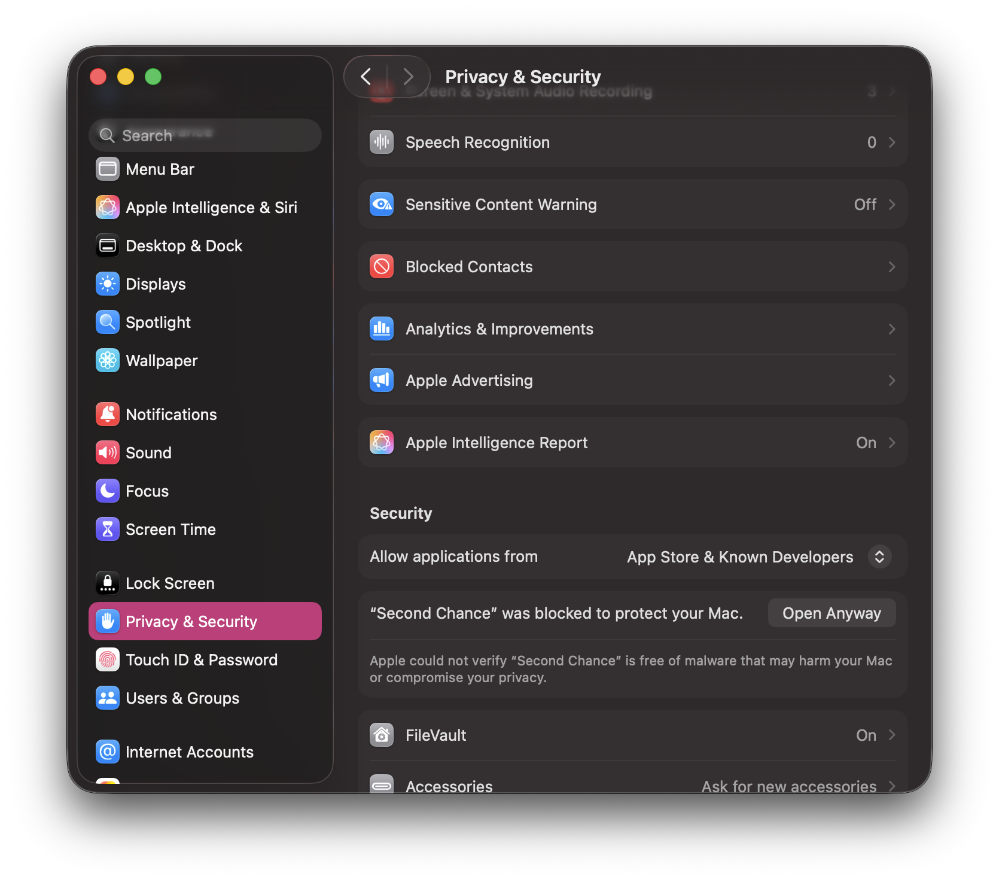
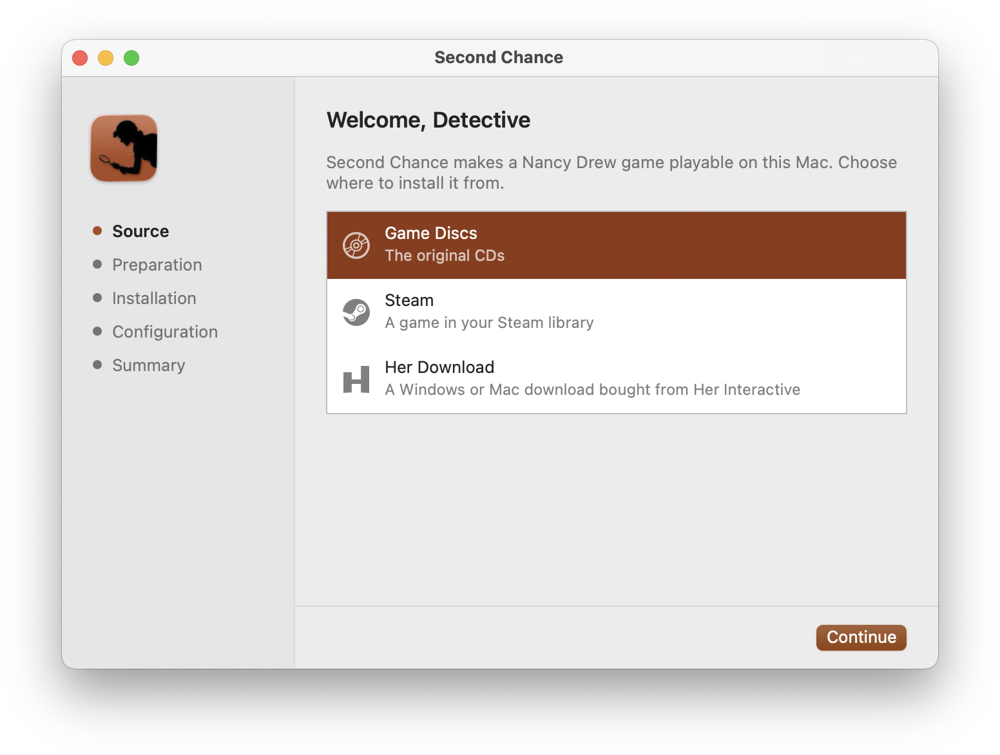

An app for running the pre-unity Nancy Drew video games on modern Macs. It (should hopefully) work for all the Nancy Drew games before "Midnight in Salem".

<p align="center">
    
</p>

> [!WARNING]
> This project is still very new and there will be bugs. I've tried to make it as user friendly as possible but keep in mind there are still some rough edges. Please let me know if you run into any issues using it.

Want to play the Nancy Drew adventure games but you own a Mac and can't get them to run?  That's where Second Chance
comes in. You tell it where to find your copy of one of the Nancy Drew games and it will create a playable version of
the game as a new app. It works with the CD versions of the games, the versions on Steam, and copies downloaded directly
from the Her Interactive website (the Windows download, or the Mac one for games whose Mac version was made with Cider).


## Using Second Chance

To get started download **SecondChance.zip** [from the releases page](https://github.com/callumgare/second-chance/releases/latest), or with this button:

<p align="center">
    <a href="https://github.com/callumgare/second-chance/releases/latest/download/SecondChance.zip">
        
    </a>
</p>

> [!IMPORTANT]
> macOS will give you some scary warnings when you try to open it for the first time. That's because I'm too cheep to
> pay for an Apple developer membership ($99 USD a year) so the app is not officially attributed to a known developer. I pinky promise there's nothing sneaky happening (and if you're technical you
> can inspect the source code for the app in this repo).

In the most recent versions of macOS you'll likely see a warning like this on first run. Select **Done**.

<p align="center">

</p>

Now you need to open **Privacy & Security** in **System Settings**. If you scroll down to near the bottom you should
see a section that says:
> "Second Chance" was blocked to protect your Mac. [Open Anyway]



Click **Open Anyway**. You'll probably then see a final warning that looks like this:

<p align="center">

</p>

Click **Open Anyway** again to continue. macOS may then ask for your password to confirm.

Finally after all that you should see a screen like this:

<picture>
    <source media="(prefers-color-scheme: dark)" srcset="./docs/main-screen-dark.png">
    
</picture>

Once you've loaded your CD copy of any of the classic games you can select "Game Disk(s)" and point to the CD. From
there Second Chance will create a new app for that game. When done it'll ask you where you want to save it. From that
point on you can just simply open the app it created in to be able to play the game.

Have fun!

> [!NOTE]
> Small advertisement: I'd love to get rid of the scary warnings messages when you first run the app. I want Second
> Chance to be as easy to use as possible to make it accessible for even the least technically inclined. If you've found
> Second Chance helpful and you'd like to help out with that too you can send me
> [a small tip on ko-fi](https://ko-fi.com/callumgare) to allow me to buy an Apple Developer Membership. 

### Failure reports

When building a game, or one of the games Second Chance made, fails or crashes, it sends me a report so I can fix
it. Nothing is sent unless something goes wrong. The first time something fails, it asks which kind you'd like to send:
- A **basic** report has only the Second Chance and macOS versions, which game it was, and which step failed.
- A **detailed** report adds the log of what was happening, with your name and folders taken out. That log is usually
  what it takes to track the problem down.

Later reports are sent the same way. You can change that, or have it ask each time, under **Second Chance → Settings**.
Reports go to [Sentry](https://sentry.io), and [docs/failure-reports.md](docs/failure-reports.md) has exactly what's in
them.

---

## Architecture / Code History
I have many fond memories of whiling away my childhood scoping out old mansions and questioning shady characters.
So a couple of years back I decided to play though them again. However getting them to run on modern mac hardware ended
up being quite a process. I found there was limited information online, mostly buried in various forum threads and much
of which is now outdated.

Over time I pieced together the different set of tweaks and hacks required to get each game to run. To make running them
a bit easier I started a (then simple) bash script to help automate the creation of a Wine wrapper for some of the
games. Over time the scope and complexity grew and grew and it ballooned into something way bigger than a shell scripts
should be used for. I did my best to keep it organised in a readable way but it was quite brittle and didn't have good
prospects for long-term maintainability.

I'd never written any swift before otherwise I probably would have switched to building it as a proper Mac app a lot
earlier when doing such a port would have been a lot more straightforward. However with with heavy use of Claude I ended
up migrating it. The code is pretty terrible to be honest but my main focus was just getting it working. I hope to clean
that up over time.

There's 2 main components, the game wrapper app and the second chance app.

### The Game Wrapper App
This acts as a container which is responsible for running the game. It includes everything necessary to run the game
except for the game files themselves until the user uses Second Chance install the game into a copy of the Game Wrapper app.

### The Second Chance App
This provides a user interface for taking the game installer files and installing them inside a copy of the wrapper app.

## Testing

### Quick Start
```bash
# Run fast unit tests (~5 seconds)
./sc test unit

# Test one specific game
./sc test integration scarlet-hand

# Test all games (takes a bit over an hour and will regularly bring a full screen window to the front)
./sc test integration
```

`./sc` is the developer CLI for building, running, testing and releasing —
`./sc --help`, or see [docs/dev-cli.md](docs/dev-cli.md).

## Development

Good luck (and also thank you very much for considering helping out).

### Prerequisites

- **Xcode** (16 or later) — provides `xcodebuild`, Swift 5.0, and macOS SDK
- **Homebrew** packages:
  ```bash
  brew install xcbeautify xctesthtmlreport
  ```
  `xcbeautify` pretty-prints build/test output; `xctest-html-report` generates HTML test reports.
  `./sc setup` checks for these (and `cocogitto`, for releases) and installs the commit hook.

All other dependencies (Wine, ScummVM, winetricks, AutoIt, exiftool) are automatically downloaded and cached in `~/Library/Caches/SecondChance/` during the build process — you don't need to install them yourself.


### Building

```bash
./sc app build      # or ./sc app run to build and launch it
```

That's the whole thing on a fresh machine — `sc` already handles the architecture
setup described below. The first run also builds `sc` itself (a Swift package in
`Tools/sc/`), which takes half a minute.

#### A note on architectures

The `WrappTemplate` target is `ARCHS = x86_64`, because Wine is 32-bit. Everything else in
the project is universal. This matters on Apple Silicon: a default build only builds the
*active* architecture (arm64), so Swift Package Manager emits swift-log for arm64 alone.
`WrappTemplate` then compiles as x86_64, finds only an arm64 slice of the module, and the
build dies with:

```
module file '.../Logging.swiftmodule/arm64-apple-macos.swiftmodule' is incompatible with
this Swift compiler: built for incompatible target
unable to resolve module dependency: 'Logging'
```

The fix is `ONLY_ACTIVE_ARCH=NO`: swift-log gets an x86_64 slice alongside the arm64 one,
`WrappTemplate` links, and the app itself still builds native rather than Rosetta-only.
`sc` and CI both set it.

Wrapping the build in `arch -x86_64` looks like it should work too, and the old build script used to
do exactly that. Don't — the architecture of the `xcodebuild` process doesn't reliably
decide what the build system picks for the Swift package products, so it works on some
machines and fails on others with the error above. The build setting is the thing that
actually decides.

So if you're invoking `xcodebuild` by hand rather than using `sc`, pass it:

```bash
rm -rf DerivedData    # clear any arm64-only Logging module left behind
xcodebuild -project SecondChance.xcodeproj \
    -scheme SecondChance \
    -configuration Debug \
    -derivedDataPath DerivedData \
    ONLY_ACTIVE_ARCH=NO \
    build
```

If you're building from Xcode's GUI, set **Build Settings → Build Active Architecture Only
→ Debug → No**, otherwise you'll hit the same error.

`sc test` sets the same flag, so tests run natively too:

```bash
./sc test unit
```

It still pins `-destination` to a single architecture, but only to stop xcodebuild matching
both arm64 and x86_64 and launching two parallel test runners, which doubles Wine installs
on integration runs.


## Built with
- [wine](https://www.winehq.org/)
- [cnc-ddraw](https://github.com/FunkyFr3sh/cnc-ddraw) - I couldn't seem to get the games to run with the builtin wine
  DirectX implementation but cnc-ddraw seems to fix that.
- [ScummVM](https://www.scummvm.org/) - Currently ScummVM just supports some of the earlier games but support more games
  is being actively worked on.
