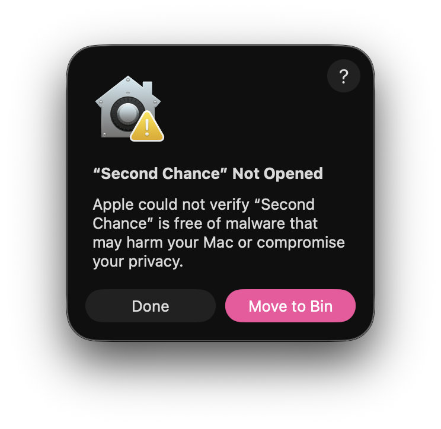
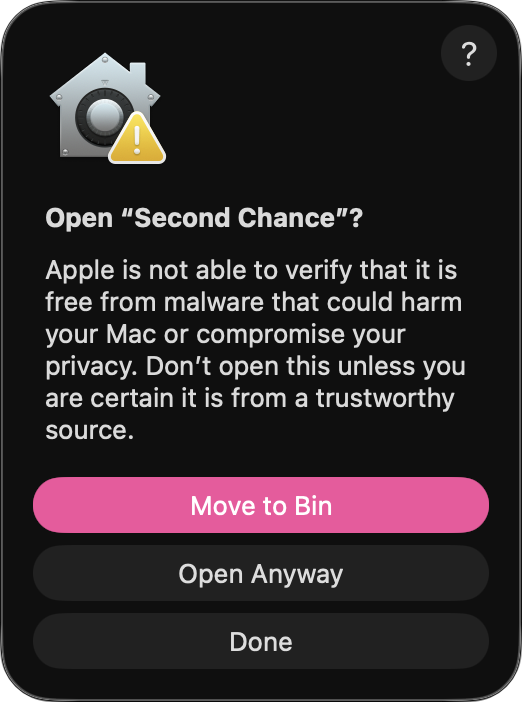

# Second Chance

    

**Play the classic Nancy Drew games on a modern Mac.**

Second Chance works with the Nancy Drew adventure games from _Secrets Can Kill_ through to _Sea of Darkness_, every
game made before Her Interactive moved to a new game engine with _Midnight in Salem_. You tell it where your copy of a
game is, and it makes a new app that runs that game.

It works with copies of the games from the original CDs, games from Steam, and both Mac and PC copies of the games downloaded from the online Her
Interactive store (although this is the least tested of the 3, let me know if you find any issues with it).

<picture>
    <source media="(prefers-color-scheme: dark)" srcset="docs/main-screen-dark.png">
    
</picture>

> [!NOTE]
> Second Chance is still new, so you may run into bugs. If you do, please
> [let me know](https://github.com/callumgare/second-chance/issues) and I'll do my best to fix them.

## What you'll need

- A Mac running **macOS 15 (Sequoia)** or later.
- Your own copy of one of the [games listed below](#which-games-have-been-verified-to-work).

## Download

> [!IMPORTANT]
> macOS will give you some scary warnings when you try to open it for the first time. That's because I'm too cheep to
> pay for an Apple developer membership ($99 USD a year) so the app is not registered as coming from a developer Apple
> has verified. See "Opening it for the first time" below for more info.

Download **SecondChance.zip** [from the releases page](https://github.com/callumgare/second-chance/releases/latest), or
with this button:

    

Open the zip file to get the **Second Chance** app, then drag it into your **Applications** folder.

## Opening it for the first time

Despite the warnings I pinky promise there's
nothing sneaky going on (and if you're technical, all of the app's code is here for you to look through). You only have
to do this once.

1. Open Second Chance. You'll likely see a warning like this. Click **Done**.

   

   
   

2. Open **System Settings** and go to **Privacy & Security**. Scroll down near to the bottom and you should see:

   > "Second Chance" was blocked to protect your Mac. [Open Anyway]

   

   Click **Open Anyway**.

3. You'll probably see one last warning like this. Click **Open Anyway** again. macOS may ask for your password to
   confirm.

   

   
   

4. If Second Chance is still in your Downloads folder (or wherever the zip put it), it asks to move itself into
   your **Applications** folder. Click **Move to Applications** and it reopens from there. Until it's moved, macOS
   runs a hidden copy of it that can't install updates.

After all that, Second Chance opens and asks where to install your game from.

## Which games have been verified to work?

Second Chance knows about all 33 of these games but not all games have been been tested on all platforms. If one of them doesn't work for you, please
[let me know](https://github.com/callumgare/second-chance/issues).

<strong>Show the list of games</strong>

Key:\
**✓** tested and working\
**–** not tested yet\
**n/a** not sold on this platform

| #   | Game                           | CD  | Steam | Her Download |
| --- | ------------------------------ | :-: | :---: | :----------: |
| 1   | Secrets Can Kill               | ✓   | n/a   | n/a          |
|     | Secrets Can Kill Remastered    | ✓   | ✓     | –            |
| 2   | Stay Tuned for Danger          | ✓   | n/a   | –            |
| 3   | Message in a Haunted Mansion   | ✓   | ✓     | –            |
| 4   | Treasure in the Royal Tower    | ✓   | ✓     | –            |
| 5   | The Final Scene                | ✓   | –     | –            |
| 6   | Secret of the Scarlet Hand     | ✓   | –     | ✓ (Windows)  |
| 7   | Ghost Dogs of Moon Lake        | ✓   | ✓     | –            |
| 8   | The Haunted Carousel           | ✓   | –     | –            |
| 9   | Danger on Deception Island     | ✓   | –     | –            |
| 10  | The Secret of Shadow Ranch     | ✓   | ✓     | –            |
| 11  | Curse of Blackmoor Manor       | ✓   | ✓     | –            |
| 12  | Secret of the Old Clock        | ✓   | ✓     | –            |
| 13  | Last Train to Blue Moon Canyon | ✓   | ✓     | –            |
| 14  | Danger by Design               | ✓   | –     | –            |
| 15  | The Creature of Kapu Cave      | ✓   | –     | –            |
| 16  | The White Wolf of Icicle Creek | ✓   | –     | –            |
| 17  | Legend of the Crystal Skull    | ✓   | –     | –            |
| 18  | The Phantom of Venice          | ✓   | –     | –            |
| 19  | The Haunting of Castle Malloy  | ✓   | –     | –            |
| 20  | Ransom of the Seven Ships¹     | ✓   | n/a   | n/a          |
| 21  | Warnings at Waverly Academy    | ✓   | ✓     | –            |
| 22  | Trail of the Twister           | ✓   | –     | ✓ (Mac)      |
| 23  | Shadow at the Water's Edge     | ✓   | ✓     | –            |
| 24  | The Captive Curse              | ✓   | –     | –            |
| 25  | Alibi in Ashes                 | ✓   | –     | –            |
| 26  | Tomb of the Lost Queen         | ✓   | –     | –            |
| 27  | The Deadly Device              | ✓   | –     | –            |
| 28  | Ghost of Thornton Hall         | ✓   | ✓     | –            |
| 29  | The Silent Spy                 | ✓   | –     | –            |
| 30  | The Shattered Medallion        | ✓   | –     | –            |
| 31  | Labyrinth of Lies              | ✓   | –     | –            |
| 32  | Sea of Darkness                | ✓   | –     | –            |

¹ Her Interactive stopped selling Ransom of the Seven Ships in 2020. If you have a copy bought before then it may still work.

## Something not working?

<b>The game won't start, or making the game app failed</b>

You should hopefully get a prompt asking you to send a report. Please pick the detailed report option (all your personal
details are removed) so I have the most chance of tracking down what the issue is and fixing it.

See "How do I get updates?" for info on updating the game apps which may fix the issue if there's been a fix released in
the mean time.

<b>Where are my saved games?</b>

Saved games are kept outside the game's app, so deleting the app or making it again doesn't lose them. Each game has
its own folder in your Library folder, at `~/Library/Application Support/au.gare.callum.SecondChance.nancy-drew.<game>`.
To get there, open Finder, choose **Go → Go to Folder…**, and type `~/Library/Application Support`.

<b>How do I get updates?</b>

Second Chance checks for new versions by itself and offers to install them. You can also choose
**Second Chance → Check for Updates…**.

The game apps don't update automatically but if a previously running game has stopped running you can check if there's a
new version of Second Chance available and if so update that then use that to recreate the game app which may fix the
problem. Your saved games are kept separate from the game app itself so you can replace the game app without losing your saves.

<b>How do I remove a game?</b>

Drag the game's app to the Trash. Its saved games stay where they are (see above), in case you want to make it again
later.

<b>What does Second Chance send, and when?</b>

When making a game app fails, or a game app crashes, Second Chance can send me a report so I can fix it. Nothing is
sent unless something goes wrong. The first time something fails, it asks which kind of report you'd like to send:

- A **basic** report has only the Second Chance and macOS versions, which game it was, and which step failed.
- A **detailed** report adds the log of what was happening, with your name and folders taken out. That log is usually
  what it takes to track the problem down.

After the first game you add, Second Chance also asks whether to send **success reports**. Say yes, and each time a
game is set up or played it says which game, where it came from, and whether it worked, so I can tell which games are
known to work. Nothing about you or your files is sent. If you say no, nothing is sent until something goes wrong.

You can change your choices, or have it ask each time something fails, under **Second Chance → Settings**. Reports go
to [Sentry](https://sentry.io); [docs/failure-reports.md](docs/failure-reports.md) has exactly what's in them.

## Helping out

I'd love to get rid of the scary warnings when you first open Second Chance. I want it to be as easy to use as
possible, so that anyone can play these games again. If Second Chance has helped you and you'd like to help with that
too, you can send me [a small tip on ko-fi](https://ko-fi.com/callumgare) towards an Apple developer membership.

Want to help with the code? Thank you! [CONTRIBUTING.md](CONTRIBUTING.md) explains how to get started.

## Why I made this

I have many fond memories of whiling away my childhood scoping out old mansions and questioning shady characters. So a
couple of years back I decided to play through them again. However, getting them to run on a modern Mac ended up being
quite a process. There was limited information online, mostly buried in forum threads, and much of it now out of date.

Over time I pieced together the set of tweaks and hacks each game needed, and started automating them so that anyone
could get the games running without having to do the same detective work. Second Chance is the result.

## Credits

Second Chance is built on:

- [Wine](https://www.winehq.org/), which lets Windows programs run on a Mac. Special thank you to all the devs who've
  put countless hours into it, you're the real heros!
- [Sikarugir (and it's Wineskin ancestor)](https://github.com/Sikarugir-App/Sikarugir), while not used directly is both
  a heavy inspiration for Second Chance (it helped me confirm that it was possible to run the games today with the right
  tweaks) and also provides the compiled wine binaries used by Second Chance.
- [winetricks](https://github.com/Winetricks/winetricks), which sets up a bunch of the Windows parts the games need.
- [cnc-ddraw](https://github.com/FunkyFr3sh/cnc-ddraw), which fixes the graphics for the games Wine can't draw well on
  its own.
- [ScummVM](https://www.scummvm.org/), which runs some of the earlier games natively. ScummVM's support for more of the
  games is being actively worked on.
- [AutoIt](https://www.autoitscript.com/), which clicks through the game installers and patches for you.
- [ExifTool](https://exiftool.org/), which helps work out which game is on a disc.
- [Sparkle](https://sparkle-project.org/), which keeps Second Chance up to date.

The Nancy Drew games are made by Her Interactive. Second Chance isn't affiliated with Her Interactive (yet, if you're
reading this Her Interactive sponsor me!).

Second Chance is open source, under the [GNU General Public License v3](license.txt).
